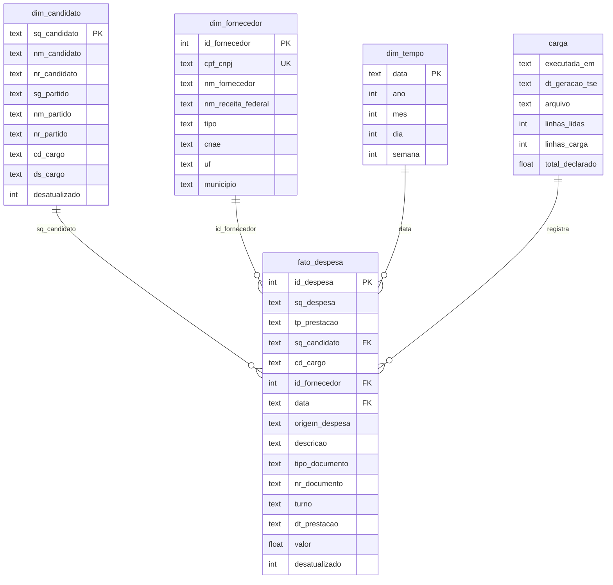
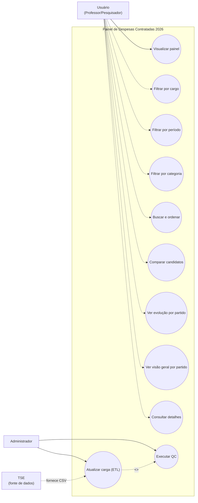
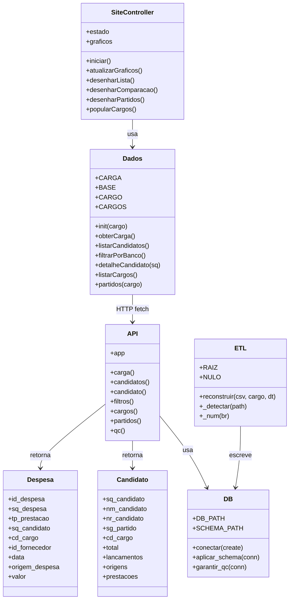

# Diagramas do Projeto

Diagramas do painel de despesas contratadas 2026. Cada seção tem a fonte
**Mermaid** (editável, renderiza no GitHub) e o SVG/PNG correspondente na pasta
[`diagramas/`](diagramas/).

- [MER (Entidade-Relacionamento)](diagramas/mer.svg) · [PNG](diagramas/mer.png)
- [Casos de Uso](diagramas/casos_de_uso.svg) · [PNG](diagramas/casos_de_uso.png)
- [Classes](diagramas/classes.svg) · [PNG](diagramas/classes.png)

## 1. MER — Modelo Entidade-Relacionamento

Modelo dimensional: uma tabela fato (`fato_despesa`) ligada às dimensões
`dim_candidato`, `dim_fornecedor` e `dim_tempo`, mais a tabela `carga` (metadados
da importação) e as tabelas `resumo_*` (agregados pré-computados).

**Agregados (`resumo_*`)** — derivados de `fato_despesa`/`dim_candidato`:
`resumo_candidato`, `resumo_cargo`, `resumo_partido_cargo`,
`resumo_origem_cargo`, `resumo_mes_cargo`, `resumo_serie_cargo`,
`resumo_prestacao_candidato`.

## 2. Casos de Uso

Atores: **Usuário** (Professor/Pesquisador), **Administrador** e **TSE** (fonte
de dados). O usuário visualiza o painel; filtros, busca, comparação e detalhes
estendem o caso principal. O administrador atualiza a carga (ETL), que inclui a
execução do QC. O TSE fornece o CSV.

## 3. Diagrama de Classes

Camadas: **front** (`Dados`, `SiteController`), **API** (`API`), **banco**
(`DB`, `ETL`) e **domínio** (`Candidato`, `Despesa`).

